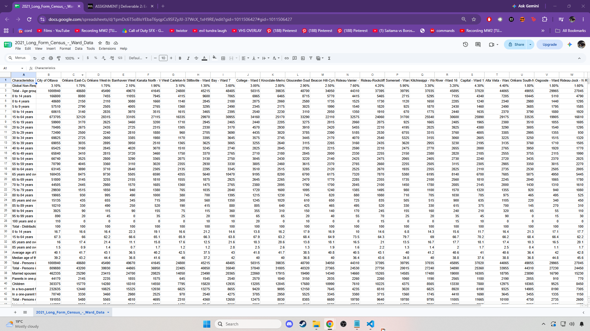
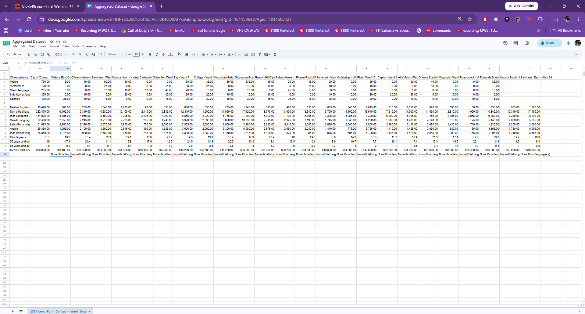

**10/31/26**<br>
**MPAD2003A & Introductory Data Storytelling**<br>
**Carlos & Valdez**<br>
**Presented to Jean-Sébastien Marier**<br>

# Deliverable 2: Exploratory Data Analysis (EDA)

# Official Bilingualism Vs. Everyday Reality: Language Barriers in Ottawa Healthcare

## Foreword

This exploratory data analysis examines the structural and demographic distribution of non-official language speakers across Ottawa's municipal wards using the City of Ottawa's 2021 Long Form Census Ward Dataset.  Building on my initial story pitch, this report demonstrates whether local health equity and community health services keep pace with the city's rapidly diversifying multilingual neighbourhoods; specifically focusing on key wards such as Rideau-Vanier and Somerset.

**Here are some useful resources for this assignment:**

* [GitHub's *Basic writing and formatting syntax* page](https://docs.github.com/en/get-started/writing-on-github/getting-started-with-writing-and-formatting-on-github/basic-writing-and-formatting-syntax)
* [The template repository for this assignment in case you delete something by mistake](https://github.com/jsmarier/jou4100_jou4500_mpad2003_project2_template)

Did you notice how to create a hyperlink? In Markdown, we put the clickable text between square brackets and the actual URL between parentheses.

And to create an unordered list, we simply put a star (`*`) before each item.

## 1. Getting Data

For my exploratory analysis, I have selected the 2021 Long Form Census Ward Dataset published on [Open Ottawa].  (https://open.ottawa.ca/datasets/ottawa::2021-long-form-census-ward-data/about)

Currently, to import this data into Google sheets, I downloaded the raw .csv file directly from their portal.  Next, I imported the file into sheets, using "Replace spreadsheet" to populate the rows.  The imported dataset can be accessed via my [Public Google Sheets Spreadsheet]  (https://docs.google.com/spreadsheets/d/1frPs9xn0qgetXE0PTjPqiEm5rBZTXNIspGW2AnpYdj8/edit?usp=sharing)

<br>
*Figure 1: The Imported 2021 Long Form Census Dataset in Google Sheets.*

### General & Specific Observations

In total there are 2,603 rows and 26 columns in this dataset, I'd say overall the data looks clean enough.  
It is a lot to look at though and puts strain on my eyes, so to effectively visualize this data I will be only selecting and comparing relevant columns & rows given a posed question/depending on the angle I am exploring.

A few key variables I've noticed in Column A specifically, featuring discrete and continuous numerical variables representing aggregated census values for each specific Ward in Ottawa include: 
    
    - Rows tracking household sizes represent discrete numerical variables tracking counts of private households. (e.g. 2 persons, 3 persons)
    - Rows tracking financial metrics represent continuous numerical variables capturing monetary amounts. (e.g. Median monthly shelter cost, Average value of dwelling)
    - Rows tracking percentages represent continuous ratio variables measured as precentages. (e.g. % of owner households in core need)

## Out of the Ordinary Observations to Note:

I have noticed rows and specific cells showing '0' or ellipses (...) depending on data suppression rules applied by Statistics Canada to protect privacy in low population dissemination areas or specific wards.

### Potential Hypothesis:

Despite Ottawa's official bilingual designation, the rapid growth of non-official mother tongues led by Arabic and Mandarin highlights a shifting linguistic landscape that challenges traditional bilingual service delivery in certain municipal wards.  

**Here are examples of functions and lines of code put in grey boxes:**

1. If you name a function, put it between "angled" quotation marks like this: `IMPORTHTML`.
1. If you want to include the entire line of code, do the same thing, albeit with your entire code: `=IMPORTHTML("https://en.wikipedia.org/wiki/China"; "table", 5)`.
1. Alternatively, you can put your code in an independent box using the template below:

``` r
=IMPORTHTML("https://en.wikipedia.org/wiki/China"; "table", 5)
```
This also shows how to create an ordered list. Simply put `1.` before each item.

## 2. Understanding Data


### VIMO Analysis

To instill the data's reliability, I audited it using the VIMO framework as mandatory (Validity, Integrity, Completeness, and Accuracy).  I would say assessing these angles is essential before mapping out and visualizing the data, as generally it can be easy to miss errors that will lead to skewed insights and misleading narratives (Cairo, 2016).  Rather than auditing every single variable, my evaluation focuses on various primary rows driving the analysis: language metrics (non-official language speakers), age demographics (seniors), and median income.  Connecting these specific data points is key to understanding how language barriers might affect access to local healthcare services.  

# Validity 

I made sure the columns had the correct format.  For instance, checking the rows listing non-official language speakers only had numbers and didn't have text errors that would mess up further visualizations for this EDA.

# Integrity 

I ensured the dataset stayed aligned across columns.  This meant keeping language and income data tied to the correct geographic wards so I didn't accidentally match one neighbourhoods language stats with another's healthcare needs.

# Completeness

I scanned the dataset for any missing information.  In rows showing non-official language speakrs or vulnerable groups, some smaller population numbers might be left blank by Statistics Canada for privacy.  I noted where data was missing so it wouldn't skew the healthcare access analytics.  

# Accuracy

I even took the initiative to double check numbers against logical totals.  As checking the data helps prevent basic mistakes.  Furthermore, I made sure the language breakdown numbers added up properly before drawing conclusions about the wards that might need better multilingual health resources.  

Support your claims by citing relevant sources. Please follow [APA guidelines for in-text citations](https://apastyle.apa.org/style-grammar-guidelines/citations).

**For example:**

As seen in Bounegru & Gray (2011), a data visualization should be clear...

### 2.2. Cleaning Data

To prepare the census dataset for healthcare equity analysis, three primary cleaning procedures were applied across the selected wards:

# Trimming Whitespace and Column Filtering

Using Google sheets built-in data cleanup tools ( Data > Data cleanup > Trim whitespace), all extra trailing and leading spaces in the category descriptions were stripped.  The primary ward columns (Columns N, P, T) and key demographic rows were then extracted into a focused tab, isolating non-official language speakers, age groups, and income levels to remove irrelevant census data.  

# Reorgranizing Text Strings with Formulas

To make ward headers and category labels cleaner for pivot table reporting, spreadsheet formulas were used.  The SPLIT function was used to isolate specific header text from raw CSV string parameters: =SPLIT(A2, ":").

The CONCENATE function was then used to merge language indicators directly with targeted ward numbers for clear chart labeling: concatenate(A5, " - Ward ", N$1).

# Standardizing Categories with Find and Replace

To clean up the dataset, I used the Find and Replace tool to fix up messy or shortened text labels.  Some of the raw census data had weird abbreviations like "Non-off. lang." or "Eng/Fr Neither," so I changed those to clearer names so the tables actually made sense. 
<br>
*Figure 2: The Aggregated Data; using specific columns in a new spreadsheet.*


### 2.3. Analyzing Data

To examine how these linguistic barriers crosspaths with healthcare accessibility throughout Ottawa, I conducted my EDA using a pivot table aggregation and a targeted visual comparison chart.  

## Variable Selection & Rationale

For my main focus, I zoomed in on the non-official language speakers row, the neither official language spoken row, and median income across all the Ottawa wards.  I picked these specific variables because a language barrier makes it way harder for someone to get through hospital triage, understand prescription directions, or give proper informed consent during an emergency.  Looking at these stats side by side with median income also helps show if lower income neighbourhoods are getting hit with a double whammy; meaning they not only face a language barrier, but they also do not have the spare cash to pay out of pocket for private translation or extra care.

## Pivot Table Aggregation & Key Findings

By using a pivot table I was able to consctruct the total counts of non-official language speakers alongside income baselines across target wards.  The summarization was then generated using the =COUNTA function to verify valid data points per ward: =COUNTA(C2:AA2).

## Standing Out Statistic

Looking at the numbers, a few areas really jump out.  Rideau-Vanier (Ward 12) and Somerset (Ward 14) have way more people who do not speak English or French compared to suburban places like West Carleton-March (Ward 5), and on top of that, their median household incomes are a lot lower ($39,200 compared to $56,400).

## The Potential Story & Narrative


**This section should include a screen capture of your pivot table, like so:**

<br>
*Figure 2: This pivot table shows...*

**This section should also include a screen capture of your exploratory chart, like so:**

<br>
*Figure 3: This exploratory chart shows...*

## 3. Delivering Data

Insert text here.

## 4. References

Include a list of your references here. Please follow [APA](https://apastyle.apa.org/style-grammar-guidelines/references) or [MLA](https://www.mla.org/MLA-Style) guidelines for references. Hanging paragraphs aren't required though.

**Here's an example:**

Bounegru, L., & Gray, J. (Eds.). (2021). *The Data Journalism Handbook 2: Towards A Critical Data Practice*. Amsterdam University Press. [https://ocul-crl.primo.exlibrisgroup.com/permalink/01OCUL_CRL/hgdufh/alma991022890087305153](https://ocul-crl.primo.exlibrisgroup.com/permalink/01OCUL_CRL/hgdufh/alma991022890087305153)
